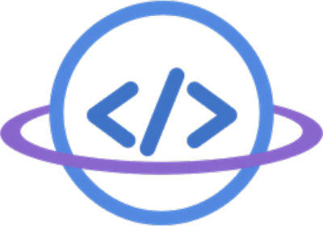
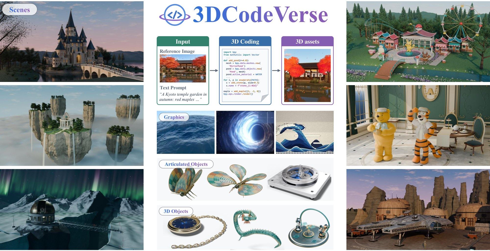
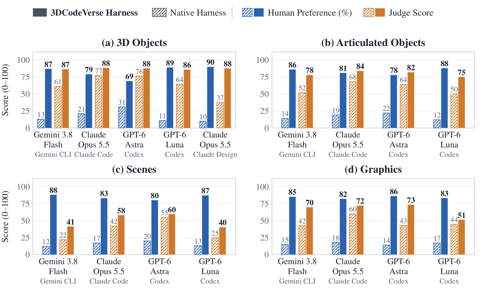
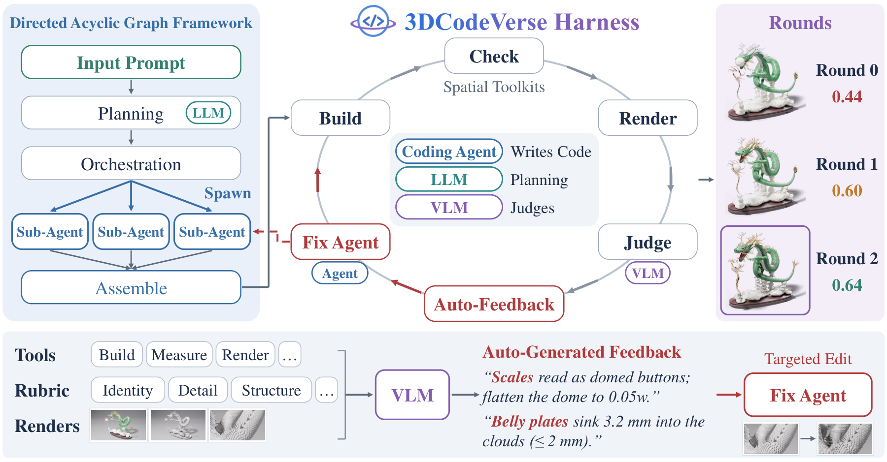
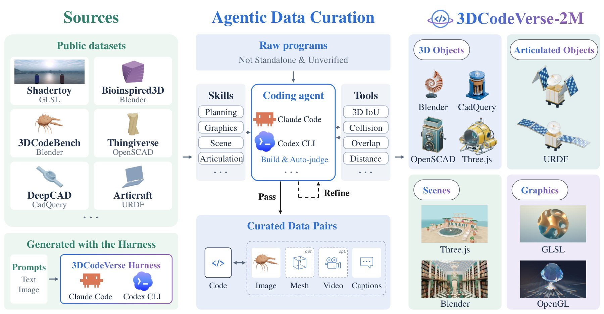

<div align="center">



# 3DCodeVerse: Exploring 3D Worlds as Code

**Yipeng Gao**<sup>1\*†</sup>, **Ziyao Zeng**<sup>2\*</sup>, **Jinfa Huang**<sup>3\*</sup>, **Yijiang Li**<sup>4\*</sup>,
Haolin Xiong<sup>1</sup>, Wang Qin<sup>1</sup>, Xinlei Yu<sup>1</sup>, Youheng Yao<sup>2</sup>,
Jie Zhang<sup>5</sup>, Kun-Yu Lin<sup>6</sup>, Rong Liu<sup>1</sup>, Yinyuan Zhao<sup>7</sup>,
Yajie Zhao<sup>1</sup>, Meiqi Guo<sup>8</sup>, Jiebo Luo<sup>3</sup>, Lei Shu<sup>8</sup>,
Yunhao Ge<sup>1</sup>, Xinyu Hu<sup>9</sup>, Laurent Itti<sup>1</sup>

<sup>1</sup>University of Southern California · <sup>2</sup>Yale University · <sup>3</sup>University of Rochester ·
<sup>4</sup>University of California, San Diego · <sup>5</sup>Columbia University ·
<sup>6</sup>Nanyang Technological University · <sup>7</sup>University of California, Santa Cruz ·
<sup>8</sup>Google DeepMind · <sup>9</sup>Philo Labs

<sup>\*</sup>Equal contribution · <sup>†</sup>Project lead

[](https://3dcodeverse.com)
[](https://huggingface.co/datasets/ilabai/3dcodeverse)
[](https://huggingface.co/datasets/ilabai/3dcodeverse-llamafactory)
[](LICENSE)

</div>

<p align="center">
  
</p>
<p align="center"><em>Every asset above is built <b>only by code</b> (Blender Python, Three.js, OpenGL, …),
from 3D objects to articulated objects, scenes and graphics renderings.</em></p>

**3DCodeVerse** is a research ecosystem that lets coding agents create **editable, verifiable 3D
content at scale**. It is the official code release of the paper and contains:

- **3DCodeVerse-2M** — a curated corpus of about 2M standalone, executable 3D programs across static
  objects, articulated assets, scenes and graphics. Each program comes with its source files and
  assets, descriptions and verification records.
- **The 3DCodeVerse Harness** — a multi-agent, DAG-structured coding harness. It plans a 3D project,
  has vendor coding agents write it as raw code, then executes, measures, renders and judges the
  result. It refines the program from that feedback with no human in the loop, and records every
  run as training data.
- **Open-model baselines and recipes** — LoRA/DPO fine-tuning of Qwen models on the corpus, and
  the execution-based evaluation stack used to score them.

## Highlights

**The harness lifts every backbone it runs.** On 100 text-to-3D object prompts, the same model
inside the 3DCodeVerse Harness beats its own native coding harness:

| Model | Native harness → 3DCodeVerse | Human preference | Judge score (0–100) |
| :-- | :-- | :-: | :-: |
| Gemini 3.8 Flash | Gemini CLI → **3DCodeVerse** | 13% → **87%** | 61.3 → **86.6** |
| Claude Opus 5.5 | Claude Code → **3DCodeVerse** | 21% → **79%** | 77.2 → **88.5** |
| GPT-6 Astra | Codex → **3DCodeVerse** | 31% → **69%** | 76.4 → **87.7** |
| GPT-6 Luna | Codex → **3DCodeVerse** | 11% → **89%** | 64.4 → **85.9** |
| Claude Opus 5.5 | Claude Design → **3DCodeVerse** | 10% → **90%** | 37.4 → **87.7** |

The same pattern holds on articulated objects, scenes and graphics, with 78–88% human preference.

<p align="center"></p>

**Fine-tuning on 3DCodeVerse-2M makes open models execute.** The table reports execution rate (%)
on 805 fixed tasks:

| Model | 3DCodeBench | Blender | CadQuery | OpenSCAD | GLSL | Three.js |
| :-- | :-: | :-: | :-: | :-: | :-: | :-: |
| Qwen3.5-9B | 0.0 | 1.9 | 10.5 | 50.0 | 33.0 | 72.5 |
| &nbsp;&nbsp;+ SFT | **84.9** | **90.3** | **98.5** | **86.0** | **56.0** | **74.5** |
| Qwen3.8-27B | 51.9 | 74.8 | 65.5 | 80.0 | 57.0 | 72.5 |
| &nbsp;&nbsp;+ SFT + DPO | **92.9** | **93.2** | **98.5** | **90.0** | **71.5** | **92.5** |

## How it works

<p align="center"></p>

An LLM planner defines the target asset, and a DAG of sub-agents codes and assembles a 3D program.
Every round, the harness collects three kinds of feedback:

1. **Execution** — build and runtime logs.
2. **Measurement** — dimensions, contacts, collisions, kinematics and placement, reported per part
   with numerical correction hints.
3. **Vision** — a rubric-guided VLM judge on labelled multi-view renders.

The score is computed in code from rubric weights, defect penalties and measured caps, and the
measurements veto visual claims they rule out. The feedback becomes localized repair tasks for a fix
agent, and the best-scoring round is the deliverable. Because every round is recorded, including
successes, failures, repairs and preference pairs, the harness also serves as the corpus's data
engine.

<p align="center"></p>

## Repository layout

```
 harness/                    toolkits/                        finetune/
 coding agents write 3D ───▶ curate + verify + package ─────▶ train & evaluate open models
 code: plan→DAG→gate→render  corpus → LLaMA-Factory sets      LoRA / SFT / DPO;
 →judge→refine, every run    (real compilers & renderers      scored by eval/llm/ (3DCodeBench
 recorded for the flywheel    check every sample)               + per-dialect executors)
        ▲                                                            │
        └──────────── better generators / judges ◀───────────────────┘
```

### [`harness/`](harness/) — the 3DCodeVerse Harness

Python dist `3dcodeverse` (import `codeverse3d`, CLI `3dcodeverse` / `3dcode`). Models write
**raw** 3D code, never an SDK, across four tracks (`static_object` · `articulated_object` ·
`scene` · `graphics`) and seven languages: Blender `bpy`, CadQuery, Three.js, URDF, scene
Three.js, GLSL and OpenGL. The harness owns everything around the code:

- typed plans and deterministic gates (connectivity, contract, joint sweeps, frame metrics);
- a spatial toolbox served to the coding agent over MCP, and labelled multi-view renders;
- a rubric VLM judge with binary defect checklists and caps computed in code;
- an optional text-to-image texture pass;
- a git-versioned record of every round.

The coding agent is always a vendor's CLI: Antigravity (`agy`, for Gemini models), `claude-code`
or `codex`. Single-shot generation on any Gemini / Anthropic / OpenAI chat model is also supported.

```bash
bash harness/setup.sh        # python deps + node runtime + doctor (Linux, python 3.13, node 20.6+)
3dcode make "a mid-century wooden dining chair" --track static_object --language blender
3dcode gallery serve         # browse every run in the browser
```

Start at [`harness/README.md`](harness/README.md). Design and operation are documented in
`harness/docs/` (ARCHITECTURE, INSTALL, RUNBOOK, DECISIONS, COST).

### [`eval/`](eval/) — evaluating the harness, and evaluating a bare LLM

Two evaluations, both kept apart from what they evaluate:

- [`eval/bench/`](eval/bench/) measures **the harness**. Prompt batteries run through it and
  through one-shot and bare-agent arms under one fixed judge; it also holds paired A/B rigs,
  offline re-judging and reports.
- [`eval/llm/`](eval/llm/) measures **a bare LLM / VLM** on text → 3D code and image → 3D code
  (3DCodeBench and held-out dialect sets). Every answer is executed and scored against references.

Protocols and recorded comparisons are in `eval/docs/`. Nothing under `harness/` imports from
`eval/`.

### [`toolkits/`](toolkits/) — raw 3D projects → trainable data

Everything that operates on data rather than models:

- the installable `3dcode-data` contributor CLI (validate / dedupe / execute / render / push), with
  per-dialect modules for Blender-Python, CadQuery, build123d, FreeCAD and OpenSCAD;
- per-source curation pipelines, including the DeepCAD → CadQuery and Articraft → CadQuery + URDF
  conversions;
- the LLaMA-Factory dataset builders.

Every sample is checked with the real compilers and headless renderers, because *compiling is not
drawing*. The corpus is published as
[`ilabai/3dcodeverse`](https://huggingface.co/datasets/ilabai/3dcodeverse). See
[`toolkits/README.md`](toolkits/README.md).

### [`finetune/`](finetune/) — training open models on 3DCodeVerse

Reproducible recipes on **unpatched LLaMA-Factory**: LoRA and ZeRO-3 full-parameter SFT, plus
execution- and geometry-feedback DPO. Training sets ship as
[`ilabai/3dcodeverse-llamafactory`](https://huggingface.co/datasets/ilabai/3dcodeverse-llamafactory).
Results and conclusions are in [`finetune/docs/REPORT.md`](finetune/docs/REPORT.md), and the full
experiment log is [`finetune/llm_finetune_exps.md`](finetune/llm_finetune_exps.md).

## Citation

If you find 3DCodeVerse useful, please cite:

```bibtex
@misc{gao2026_3dcodeverse,
  title  = {3DCodeVerse: Exploring 3D Worlds as Code},
  author = {Gao, Yipeng and Zeng, Ziyao and Huang, Jinfa and Li, Yijiang and Xiong, Haolin and
            Qin, Wang and Yu, Xinlei and Yao, Youheng and Zhang, Jie and Lin, Kun-Yu and
            Liu, Rong and Zhao, Yinyuan and Zhao, Yajie and Guo, Meiqi and Luo, Jiebo and
            Shu, Lei and Ge, Yunhao and Hu, Xinyu and Itti, Laurent},
  year   = {2026},
  url    = {https://3dcodeverse.com}
}
```

## License

The code is licensed under [Apache-2.0](LICENSE). The published datasets carry their own terms
(CC-BY-NC-SA, non-commercial); see each dataset card.
