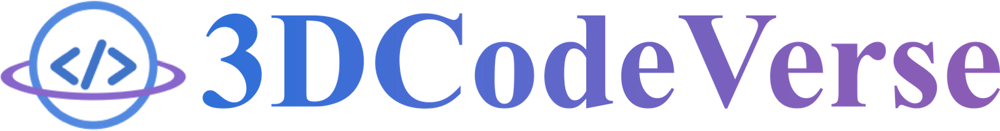
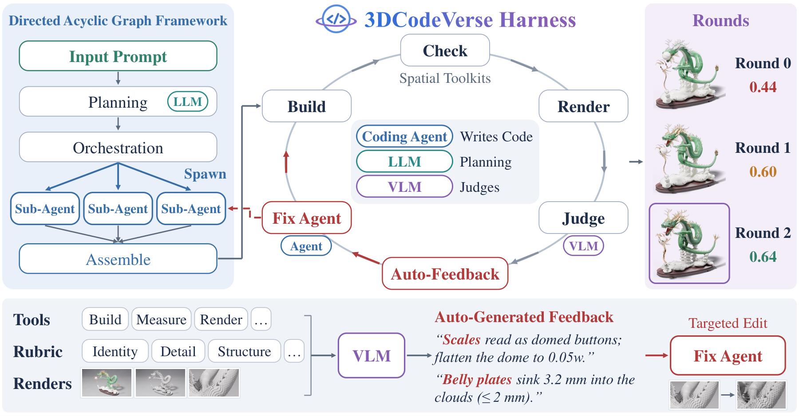
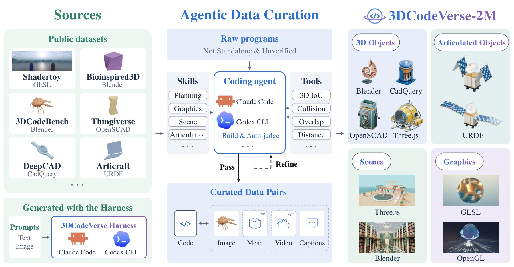
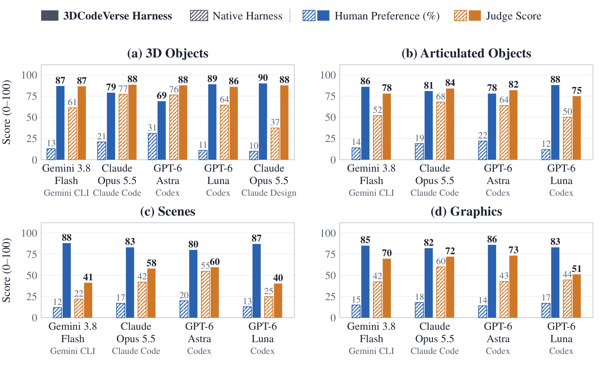

<div align="center">



<h2>Exploring 3D Worlds as Code</h2>

<p>
<a href="https://gaoypeng.github.io/"><b>Yipeng Gao</b></a><sup>1*†</sup>, <a href="https://adonis-galaxy.github.io/homepage/"><b>Ziyao Zeng</b></a><sup>2*</sup>, <a href="https://infaaa.github.io/"><b>Jinfa Huang</b></a><sup>3*</sup>, <a href="https://williamium3000.github.io/"><b>Yijiang Li</b></a><sup>4*</sup><br>
<a href="https://haolinxiong.com/">Haolin Xiong</a><sup>1</sup>, <a href="https://www.linkedin.com/in/wang-qin">Wang Qin</a><sup>1</sup>, <a href="https://xinleiyuleo.com/">Xinlei Yu</a><sup>1</sup>, <a href="https://lionelyao.github.io/">Youheng Yao</a><sup>2</sup>, <a href="https://www.linkedin.com/in/jie-zhang-6907a1328">Jie Zhang</a><sup>5</sup>, <a href="https://kunyulin.github.io/">Kun-Yu Lin</a><sup>6</sup>, <a href="https://rongliu-leo.github.io/">Rong Liu</a><sup>1</sup>, <a href="https://yzhao321.github.io/">Yinyuan Zhao</a><sup>7</sup>, <a href="https://www.yajie-zhao.com/">Yajie Zhao</a><sup>1</sup><br>
<a href="https://meiqiguo.github.io/">Meiqi Guo</a><sup>8</sup>, <a href="https://www.cs.rochester.edu/u/jluo/">Jiebo Luo</a><sup>3</sup>, <a href="https://leishu02.github.io/">Lei Shu</a><sup>8</sup>, <a href="https://gyhandy.github.io/">Yunhao Ge</a><sup>1</sup>, <a href="https://scholar.google.com/citations?user=YK4oCiwAAAAJ&amp;hl=en">Xinyu Hu</a><sup>9</sup>, <a href="https://ilab.usc.edu/itti/">Laurent Itti</a><sup>1</sup>
</p>

<p>
<sup>1</sup>University of Southern California · <sup>2</sup>Yale University · <sup>3</sup>University of Rochester<br>
<sup>4</sup>University of California, San Diego · <sup>5</sup>Columbia University · <sup>6</sup>Nanyang Technological University<br>
<sup>7</sup>University of California, Santa Cruz · <sup>8</sup>Google DeepMind · <sup>9</sup>Philo Labs<br>
<sup>*</sup>Equal contribution · <sup>†</sup>Project lead
</p>

<a href="https://arxiv.org/pdf/2610.22341"></a>
<a href="https://3dcodeverse.com"></a>
<a href="https://huggingface.co/datasets/3dcodeverse/3dcodeverse-2m"></a>
<a href="LICENSE"></a>

</div>

## Awesome Showcase

Films rebuilt **entirely in code**, with full source and agent logs on [Hugging Face](https://huggingface.co/datasets/3dcodeverse/3dcodeverse-awesome-showcase).

| Code | Reference | Result |
| :-- | :-: | :-: |
| [link](https://huggingface.co/datasets/3dcodeverse/3dcodeverse-awesome-showcase/tree/main/openai-futures-30s) | <br>[OpenAI on X](https://x.com/OpenAI/status/2116253388883345623) | <br>Opus 5.5 by Code |

## Overview

https://github.com/user-attachments/assets/3b0b5e5f-eed0-4ffd-8ab7-f3c709e15fad

### 3DCodeVerse Harness

<p align="center"></p>

An LLM planner defines the target asset, and a DAG of sub-agents codes and assembles a 3D program.
Every round, the harness collects three kinds of feedback:

1. **Execution** — build and runtime logs.
2. **Measurement** — dimensions, contacts, collisions, kinematics and placement, reported per part
   with numerical correction hints.
3. **Vision** — a rubric-guided VLM judge on labelled multi-view renders.

The score is computed in code from rubric weights, defect penalties and measured caps, and the
measurements veto visual claims they rule out. The feedback becomes localized repair tasks for a fix
agent, and the best-scoring round is the deliverable. Because every round is recorded, including
successes, failures, repairs and preference pairs, the harness also serves as the corpus's data
engine.

### 3DCodeVerse-2M Dataset

<p align="center"></p>

## News

- **[10/15/2026]** Our [paper](https://arxiv.org/abs/2610.22341) is now available on arXiv.

## Results

<p align="center"></p>

**Fine-tuning on 3DCodeVerse-2M makes open models execute.** The table reports execution rate (%)
on 805 fixed tasks:

| Model | 3DCodeBench | Blender | CadQuery | OpenSCAD | GLSL | Three.js |
| :-- | :-: | :-: | :-: | :-: | :-: | :-: |
| Qwen3.5-9B | 0.0 | 1.9 | 10.5 | 50.0 | 33.0 | 72.5 |
| &nbsp;&nbsp;+ SFT | **84.9** | **90.3** | **98.5** | **86.0** | **56.0** | **74.5** |
| Qwen3.8-27B | 51.9 | 74.8 | 65.5 | 80.0 | 57.0 | 72.5 |
| &nbsp;&nbsp;+ SFT + DPO | **92.9** | **93.2** | **98.5** | **90.0** | **71.5** | **92.5** |

## Quick Start

The harness needs Python 3.13, Node 20.6+, Git, Gemini API keys and the Antigravity CLI (`agy`, the
default generator). Blender 5.2 LTS is optional (the `blender`, `urdf_blender` and `scene_blender`
languages). Full guide: [harness/docs/INSTALL.md](harness/docs/INSTALL.md).

```bash
cd harness
bash setup.sh                       # pip install -e . + runtime_js + headless Chrome + the agy / claude-code / codex CLIs at their latest, then `3dcodeverse doctor`
export GEMINI_API_KEYS="key1,key2"  # agy runs in Gemini-API mode on this key pool
3dcodeverse doctor                       # every row OK or WARN; a FAIL row says what to fix
3dcodeverse make "a classic park bench" --track static_object --language threejs
3dcodeverse gallery serve                # browse every run at http://127.0.0.1:8765/
```

The optional generators claude-code and codex use your local subscriptions: `--generator claude-code:<model>`
or `--generator codex:<model>`. Tracks, languages and costs per track: [harness/README.md](harness/README.md) and
[harness/docs/RUNBOOK.md](harness/docs/RUNBOOK.md); evaluation: [eval/README.md](eval/README.md).

## Repository Structure

| Directory | Description | Documentation |
| :-- | :-- | :-- |
| [`harness/`](harness/) | Agent-based 3D content generation, execution, rendering, and verification. | [Harness guide](harness/README.md) |
| [`toolkits/`](toolkits/) | General data CLI and per-source corpus curation. | [Data toolkit guide](toolkits/README.md) |
| [`finetune/`](finetune/) | LLaMA-Factory training-data preparation, supervised fine-tuning, and preference optimization for open models. | [Training guide](finetune/README.md) |
| [`eval/`](eval/) | Benchmarks and evaluation pipelines for the harness and standalone models. | [Evaluation guide](eval/README.md) |

## Citation

If you find 3DCodeVerse useful, please cite:

```bibtex
@article{gao20263dcodeverse,
  title={3DCodeVerse: Exploring 3D Worlds as Code},
  author={Gao, Yipeng and Zeng, Ziyao and Huang, Jinfa and Li, Yijiang and Xiong, Haolin and Qin, Wang and Yu, Xinlei and Yao, Youheng and Zhang, Jie and Lin, Kun-Yu and others},
  journal={arXiv preprint arXiv:2610.22341},
  year={2026}
}
```

## License

The code is licensed under [Apache-2.0](LICENSE). The published datasets carry their own terms
(CC-BY-NC-SA, non-commercial); see each dataset card.
